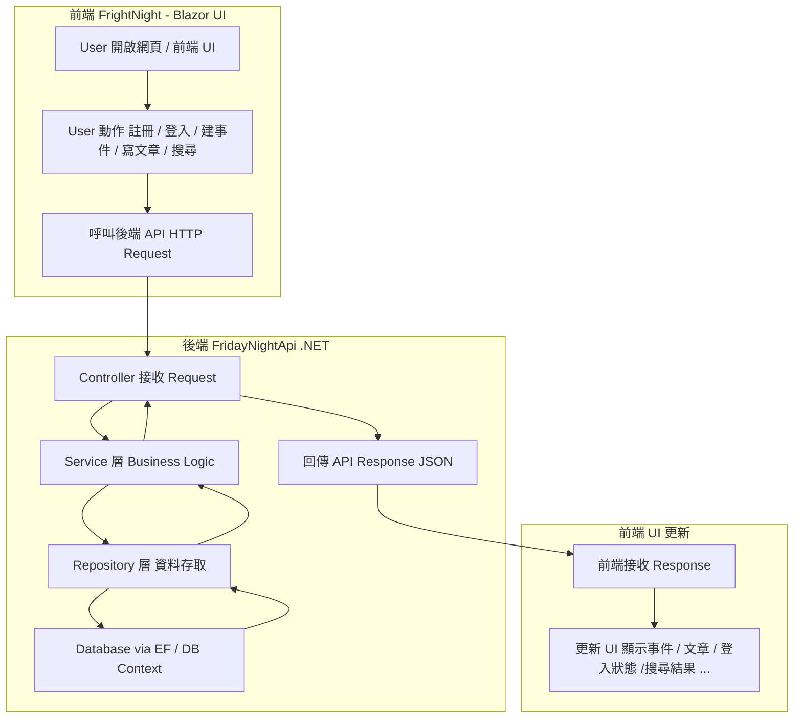

# 專案名稱
**Friday Night Memory**

# 專案描述
**Friday Night** - 日曆行事的 Blog

# 需求規格
你希望在專案中實現的功能或需求可以包括：

1. **使用者註冊與登入**：提供使用者註冊、登入和管理個人資料的功能。
2. **日曆功能**：顯示日曆，並允許使用者添加、編輯和刪除事件。
3. **事件提醒**：提供事件提醒功能，讓使用者能夠設定提醒時間。
4. **部落格文章撰寫**：使用者可以撰寫、編輯和發布文章，並能夠附加相關事件。
5. **搜尋功能**：使用者可以搜尋過去的事件和部落格文章。
6. **API 支援**：提供 Swagger API 文件，方便前端與後端的互動。

# 技術棧
- **框架**：Blazor
- **後端**：.NET 9
- **前端**：AntBlazor
- **API 文檔**：Swagger
- **UI 設計**：[Figma 設計連結](https://www.figma.com/design/g1IMxVN0vaMvv991DI5zbV/FN?node-id=68-145)

# 貢獻者
- **Galeedondon** (本人)

# 流程圖

# 授權方式
- **MIT 授權**：這是一種非常簡單和寬鬆的開源授權，允許任何人使用、複製、修改和分發軟體，只要他們在軟體的所有副本中包含原始授權聲明和版權聲明。
